# Awesome CRM Data Hygiene & Validation 🧼📊

<p align="center">
  
</p>

<p align="center">
  <a href="https://github.com/ishandutta2007/Awesome-Awesome-Awesome"></a>
  <a href="https://discord.gg/jc4xtF58Ve"></a>
  <a href="https://github.com/ishandutta2007/Awesome-CRM-Data-Hygiene-Validation/stargazers"></a>
  <a href="https://github.com/ishandutta2007/Awesome-CRM-Data-Hygiene-Validation/network/members"></a>
  <a href="https://github.com/ishandutta2007/Awesome-CRM-Data-Hygiene-Validation/blob/main/LICENSE"></a>
  <a href="https://github.com/ishandutta2007"></a>
</p>

---

## 🌟 Overview & SEO Meta Summary

Welcome to the definitive directory for **CRM Data Hygiene, Record Linkage, Deduplication, and Master Data Validation**. Clean, trusted CRM data is the foundation of high-performing Revenue Operations (RevOps), outbound deliverability, and autonomous AI agents. 

This curated collection indexes top **commercial enterprise SaaS platforms** alongside **battle-tested open-source libraries** designed for:
- 📬 **Postal Address Standardization & Normalization** (USPS CASS, DPV, international parsing)
- 📧 **Real-Time Email Verification & Deliverability Testing** (Syntax, MX records, disposable filters)
- 📞 **E.164 Phone Formatting & Carrier Validation**
- 🔄 **Probabilistic Record Linkage & Fuzzy Matching** (Deduplication at scale)
- 🛡️ **Automated Data Quality Testing & Pipeline Assertions**

**Last updated: November 2026** 📅

---

## 📑 Table of Contents

- [Sector Overview & Market Dynamics 📈](#sector-overview--market-dynamics-)
- [SaaS / Hosted Data Hygiene Platforms ☁️](#saas--hosted-data-hygiene-platforms-️)
- [Open-Source GitHub Projects & Primitives 🛠️](#open-source-github-projects--primitives-️)
- [Architecting a Self-Hosted CRM Hygiene Pipeline 🏗️](#architecting-a-self-hosted-crm-hygiene-pipeline-️)
- [Saar History 📊](#saar-history-)
- [Support & Community ☕](#support--community-)
- [How to Contribute 🤝](#how-to-contribute-)
- [Disclaimer & Best Practices ⚠️](#disclaimer--best-practices-️)

---

## Sector Overview & Market Dynamics 📈

The global data quality and CRM data hygiene tools market is estimated at **$3.3B to $3.9B in 2026** (scaling from ~$2.6B in 2024 at an ~18% CAGR), driven by enterprise demand for clean, deduplicated data for LLMs and autonomous sales agents. The sector exhibits a hybrid market structure: **moderately concentrated at the enterprise MDM tier** (dominated by entrenched enterprise providers like Experian, Informatica, and HubSpot), but **highly fragmented at the CRM point-solution and contact hygiene layer**, where dozens of niche SaaS tools, validation APIs, and AppExchange plugins compete without a winner-take-all monopoly.

---

## SaaS / Hosted Data Hygiene Platforms ☁️

| Platform | Company Size (Revenue / Valuation) 🏢 | Pricing 💰 | Free Tier / Trial Limits 🎁 | Key Capabilities & Highlights 🚀 |
| :--- | :--- | :--- | :--- | :--- |
| **[Experian Data Quality](https://www.experian.com/)** | **~$7.52B Rev (FY25) / ~$43B–$46B Market Cap** | Aperture Data Studio license starts at **£12,500/year** (~$16,000/yr on G-Cloud); enterprise deployments **$72,000–$110,000+/year**; validation APIs consume 1 credit/lookup | **14-day free trial** with ~500–2,000 validation credits (address/email/phone); no permanent free tier | Enterprise data profiling, Aperture Data Studio, global address validation engine, phone/email validation APIs |
| **[HubSpot Data Quality Tools](https://www.hubspot.com/)** | **~$3.13B Rev (FY25) / ~$21B Market Cap** | Data Hub: **Free ($0)**; Starter starts at **$7/seat/month** (500 credits); Professional at **$720/month** (5,000 credits); Enterprise at **$2,000/month** (10,000 credits) | **Free forever plan available** (Basic Data Hub features with limited deduplication view; Starter+ paid seats get complimentary basic Breeze Intelligence enrichment) | Native CRM data management, automatic deduplication formatting, AI-driven data cleansing, and Breeze Intelligence enrichment |
| **[ZoomInfo Enrich](https://www.zoominfo.com/)** | **~$1.25B Rev (FY25) / ~$1.2B Market Cap** | SalesOS Professional starts at **$15,000/year** (5,000 credits); Advanced starts at **$25,000/year** (10,000 credits); Elite starts at **$40,000/year** | **Permanent Free Lite tier available**: 10–25 free credits/month (requires contact network contribution); temporary sales-assisted proof-of-concept trial lasts **3–5 days** with custom credit limits | B2B contact verification, firmographic enrichment, automated scheduled CRM cleaning, and account hierarchy standardization |
| **[Clearbit (Breeze Intelligence)](https://www.hubspot.com/)** | **Part of HubSpot ($3.13B Rev / $21B Market Cap)** *(Acquired for ~$150M in 2023)* | Integrated into HubSpot Data Hub; basic enrichment included with paid seats ($7/seat/mo+); advanced credits cost **$10 per 1,000 credits** beyond plan allowance (Pro includes 3,000 credits/mo, Ent includes 5,000 credits/mo) | **Free tier available**: Basic contact and company enrichment included at no extra cost for all HubSpot paid Starter+ seats (no standalone free trial or public standalone API) | Real-time form shortening, buyer intent identification, company/contact enrichment, and native HubSpot synchronization |
| **[RingLead](https://www.ringlead.com/)** | **Part of ZoomInfo ($1.25B Rev / $1.2B Market Cap)** *(Acquired for ~$116M–$118M; ~$10M–$15M ARR at acquisition)* | Enterprise packages start at **$20,000 to $25,000/year** (ZoomInfo OperationsOS); mid/full tiers average **$40,000–$85,000/year** | **No permanent free tier**; sales-qualified pilot / POC trial lasts **14 to 30 days** (limited to basic routing configuration; data enrichment excluded during trial) | Point-of-entry deduplication, end-to-end lead-to-account routing, record normalization, and Salesforce/Marketo orchestration |
| **[Openprise](https://www.openprisetech.com/)** | **$100M Valuation** (Series B) / ~$4.3M–$25M Est. ARR | Professional starts at **$35,000/year** (annual contract); Enterprise custom quote based on bot runs and daily API calls | **No free tier and no self-serve trial** (sales-led custom evaluation demos only; specific API sub-components offer limited sandbox allotments) | RevOps automation, multi-source data cleansing, record unifying, deduplication bots, and lead routing |
| **[Melissa Clean](https://www.melissa.com/)** | **~$70M–$75M Est. ARR** (Bootstrapped / Private) | Credit packs start at **$40 for 10,000 credits** ($4.00 per 1,000 credits); enterprise Clean Suite CRM licenses quoted by custom tier | **Free forever tier**: **1,000 complimentary credits/month** (reloads monthly across Clean Suite, Listware, and Mailers Online; balance expires after 12 months inactivity) | Global address standardization (CASS/DPV certified), phone verification, email deliverability checks, and fuzzy deduplication |
| **[DemandTools](https://www.demandtools.com/) (Validity)** | **~$35M–$65M Est. ARR** (Parent Validity ~$300M total funding) | Elements Edition starts at **$2.67 to $3.00/user/month** (billed annually); Full V Release starts at **$10.00 to $11.00/user/month** (billed annually) | **14-day free trial** with full module access; includes 1,000 free email verification credits via DemandTools Verify (valid for 30 days; no permanent free tier) | Salesforce & Dynamics data management, mass deduplication, automated scenario matching, standardized reformatting, and lead conversion |
| **[Syncari](https://syncari.com/)** | **~$60M Implied Valuation** ($26.8M funding) / ~$1.8M–$7.1M Est. ARR | Entry-level packages start at **$995/month** (billed annually; 'One Plan' model scaled by volume of unified records) | **14-day free trial** (Test Drive account capped at 10,000 unified records; full feature exploration including automated syncs; no permanent free tier) | Agentic Master Data Management (MDM), multidirectional multi-system sync, automated deduplication, and cross-system data unification |
| **[Insycle](https://www.insycle.com/)** | **~$435K Est. ARR** (Bootstrapped / Private) | Starter starts at **$1.00 per 1,000 records/month** (~$100/mo base, billed annually, 1 module); Growth starts at **$1.50/1K records/mo** (2 modules); Professional starts at **$2.00/1K records/mo** (full suite); unlimited users | **14-day free trial** (valid for databases up to 500,000 records, no credit card required, includes health assessment; no permanent free tier) | Record-count based CRM deduplication, automated normalization rules, bulk data association, and custom deduplication formulas across HubSpot/Salesforce |

---

## Open-Source GitHub Projects & Primitives 🛠️

Sorted in descending order of GitHub community stars. Each project provides open infrastructure or foundational algorithms for self-hosted CRM data cleaning.

### 1. [google/libphonenumber](https://github.com/google/libphonenumber) [](https://github.com/google/libphonenumber/stargazers) 📞
- **Category:** Phone Parsing & International E.164 Formatting (Apache-2.0)
- **Description:** Google's gold-standard library for parsing, formatting, and validating international phone numbers across 200+ countries. Essential in CRM pipelines to standardize inconsistent lead entries into globally routable E.164 format.
- **Best for:** Eliminating malformed phone numbers before outbound calling or SMS sync.

### 2. [great-expectations/great_expectations](https://github.com/great-expectations/great_expectations) [](https://github.com/great-expectations/great_expectations/stargazers) 🛡️
- **Category:** Data Validation & Pipeline Profiling (Apache-2.0)
- **Description:** The industry-leading open-source framework for data assertions, continuous pipeline validation, and automated documentation. Allows data teams to define strict schemas (e.g., non-null contact fields, valid stage transitions, uniqueness constraints) on CRM tables.
- **Best for:** Automating CI/CD checks and warehouse data quality gates on Salesforce and HubSpot data syncs.

### 3. [openvenues/libpostal](https://github.com/openvenues/libpostal) [](https://github.com/openvenues/libpostal/stargazers) 📍
- **Category:** International Street Address Parsing & Normalization (MIT)
- **Description:** C/Python library powered by statistical NLP trained on OpenStreetMap data worldwide. Parses unstructured street address strings into structured components (house number, road, city, postal code) across every country.
- **Best for:** Normalizing global CRM address fields to enable accurate multi-field contact matching and deduplication.

### 4. [dedupeio/dedupe](https://github.com/dedupeio/dedupe) [](https://github.com/dedupeio/dedupe/stargazers) 🔍
- **Category:** Machine Learning Deduplication & Record Linkage (Apache-2.0)
- **Description:** Python library that uses active learning machine learning algorithms to perform deduplication and entity resolution on messy customer databases. Learns custom blocking rules and similarity thresholds from user feedback.
- **Best for:** Identifying duplicate accounts and contacts with conflicting or partial fields without writing hundreds of brittle regex rules.

### 5. [moj-analytical-services/splink](https://github.com/moj-analytical-services/splink) [](https://github.com/moj-analytical-services/splink/stargazers) ⚡
- **Category:** Big Data Probabilistic Record Linkage (MIT)
- **Description:** Fast, scalable probabilistic record linkage at scale based on the Fellegi-Sunter model. Native support for DuckDB, Apache Spark, and AWS Athena enables deduplicating multi-million row CRM datasets in seconds.
- **Best for:** High-volume deduplication and enterprise master customer index linking directly inside data lakes and warehouses.

### 6. [JoshData/python-email-validator](https://github.com/JoshData/python-email-validator) [](https://github.com/JoshData/python-email-validator/stargazers) 📧
- **Category:** Email Syntax, Deliverability & MX Verification (CC0)
- **Description:** A robust Python library that validates email addresses against RFC 5322 syntax specifications, checks domain DNS MX records for live mail servers, and normalizes internationalized domain names (IDNA).
- **Best for:** Instant point-of-capture validation on web forms and pre-import cleaning to protect domain sender reputation.

### 7. [J535D165/recordlinkage](https://github.com/J535D165/recordlinkage) [](https://github.com/J535D165/recordlinkage/stargazers) 🔗
- **Category:** Record Linkage & Data Matching Toolkit (BSD-3-Clause)
- **Description:** A powerful Python toolkit built on Pandas and NumPy for linking and deduplicating record sets. Includes indexing techniques (blocking, sorted neighborhood), comparison algorithms (Jaro-Winkler, Levenshtein), and classification algorithms.
- **Best for:** Data analysts needing fine-grained programmatic control over CRM merge rules in Python/Pandas workflows.

### 8. [google/libaddressinput](https://github.com/google/libaddressinput) [](https://github.com/google/libaddressinput/stargazers) 🌍
- **Category:** Postal Address Schema & Country Rule Verification (Apache-2.0)
- **Description:** Google's library handling postal address forms and validation metadata across 200+ territories. Contains authoritative rules for required fields, postal code formats, and administrative area hierarchies.
- **Best for:** Standardizing UI address input fields and validating international postal formats against official postal schemas.

### 9. [TomGranot/hubspot-admin-skills](https://github.com/TomGranot/hubspot-admin-skills) [](https://github.com/TomGranot/hubspot-admin-skills/stargazers) 🤖
- **Category:** Claude Code AI Skills for HubSpot CRM Hygiene (MIT)
- **Description:** A suite of 32 specialized Claude Code skills and prompt workflows designed for automated HubSpot audits, orphan record reassignment, contact suppression, property cleanups, and deduplication with CSV preview safety.
- **Best for:** RevOps engineers leveraging LLMs to audit and remediate dirty HubSpot portals with safe preview-before-apply steps.

### 10. [Koder-Kartik/ai-crm-sanitizer](https://github.com/Koder-Kartik/ai-crm-sanitizer) [](https://github.com/Koder-Kartik/ai-crm-sanitizer/stargazers) 🧪
- **Category:** OpenEnv Benchmark for AI Agent CRM Cleaning (MIT)
- **Description:** An OpenEnv-compliant evaluation benchmark for testing AI cleaning agent logic. Procedurally generates dirty CRM records with phone mismatches, duplicate imports, city spelling variations, and negative numeric anomalies to benchmark agent reasoning.
- **Best for:** AI developers training or evaluating autonomous agents before letting them execute destructive mutations on real CRM databases.

---

## Architecting a Self-Hosted CRM Hygiene Pipeline 🏗️

```
┌─────────────────┐       ┌──────────────────────┐       ┌──────────────────────┐
│  Messy Ingest   │ ────> │ Validation Primitives│ ────> │ Linkage & Dedupe     │
│ (Leads / Forms) │       │ (libpostal, libphone)│       │ (Splink / Dedupe)    │
└─────────────────┘       └──────────────────────┘       └──────────────────────┘
                                                                     │
                                                                     ▼
┌─────────────────┐       ┌──────────────────────┐       ┌──────────────────────┐
│ Clean CRM Core  │ <──── │ QA & Audit Assertions│ <──── │ Merge & Resolve      │
│ (Salesforce/Hub)│       │ (Great Expectations) │       │ (Surviving Records)  │
└─────────────────┘       └──────────────────────┘       └──────────────────────┘
```

1. **Ingest Normalization:** Parse raw inputs through `openvenues/libpostal` (addresses) and `google/libphonenumber` (phones) before inserting records into the staging database.
2. **Deliverability Gate:** Verify email domains via `JoshData/python-email-validator` to eliminate throwaway or defunct mailboxes.
3. **Probabilistic Deduplication:** Run `moj-analytical-services/splink` or `dedupeio/dedupe` across first name, last name, normalized company name, and address to score duplicate likelihood.
4. **Data Contract Testing:** Assert schema invariants using `great-expectations/great_expectations` to prevent pipeline regressions from corrupting production records.

---

## Saar History 📊
[](https://star-history.dera.page/#ishandutta2007/Awesome-CRM-Data-Hygiene-Validation&type=date&legend=top-left)

---

## Support & Community ☕

If you find this curated collection useful for your RevOps stack, data engineering pipelines, or open-source research, please consider supporting the project:

- 🌟 **Star the repository** to boost discoverability on GitHub!
- 🍴 **Fork the repository** and contribute your own tools, benchmarks, and guides.
- 📣 **Share with colleagues** in RevOps, Data Engineering, and SalesOps communities.
- ☕ **Sponsor the maintainer** via the [GitHub Sponsor Dashboard](https://github.com/sponsors/ishandutta2007) to help support ongoing curation and maintenance.

Thank you to all contributors and community members building open, transparent data systems! ❤️

---

## How to Contribute 🤝

1. Fork this repository 🍴
2. Create your feature branch (`git checkout -b feature/add-new-tool`)
3. Add or update entries following the table format (include revenue/valuation, starting tier prices, and explicit free tier/trial limits)
4. For open-source tools, include the repository link, GitHub star badge (`style=social&color=white`), and appropriate categorization
5. Submit a pull request with a concise overview of your additions 🚀

---

## Disclaimer & Best Practices ⚠️

- This is an independent, **community-curated directory** — listings do not constitute commercial endorsement.
- **Destructive Operation Warning:** Merging and purging CRM contacts and accounts is permanent. Always export a snapshot and preview diffs before executing mass deduplications.
- **Regulatory Compliance:** Contact and address validation systems handling customer personal records must adhere to applicable privacy legislation (GDPR, CCPA/CPRA, HIPAA).
- Commercial pricing and credit allotments are subject to vendor adjustments; always verify directly with vendor representatives during procurement.

---

<p align="center">
  <b>Built for RevOps teams, CRM admins, and Data Engineers dedicated to clean, reliable data. 🧼✨</b>
</p>
